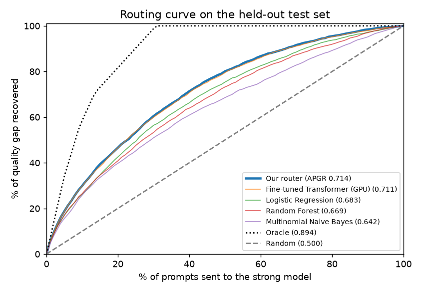

# RouteWise

**Send each prompt to the cheapest LLM that can answer it well.**

[](https://github.com/iakshatkaushik/routewise/actions/workflows/tests.yml)


[](LICENSE)

Strong LLMs cost far more than cheap ones, yet most everyday prompts don't need them.
RouteWise trains a small machine-learning **router** that reads a prompt *before any model
answers it*, predicts whether the cheap model will give a poor answer, and only then pays for
the strong model. It comes with a web app where you talk to the router and watch every routing decision
(see [The web app](#the-web-app)).



The idea follows the RouteLLM paper (Ong et al., 2024, LMSYS / UC Berkeley); every model here is trained
and tuned for this project, and Apriori is written from scratch.
The final router is a small transformer (33M parameters, run on the CPU with ONNX Runtime) that was
fine-tuned on an NVIDIA H100 and taught by a 4-billion-parameter language model (knowledge distillation).

## Results (10,000 held-out test prompts, never used for tuning or model selection)

| | Final router (`ROUTER_MODE=full`) | Light router (`ROUTER_MODE=light`) | Random routing | Perfect router |
|---|---|---|---|---|
| **APGR** (share of quality gap recovered, averaged over all budgets) | **0.714** | 0.685 | 0.500 | 0.894 |
| ROC-AUC for "cheap model will fail" | **0.802** | 0.764 | 0.500 | 1.000 |
| Strong-model calls needed for 50% of the quality gap (CPT50) | **23%** | 25% | 50% | 9% |
| Strong-model calls needed for 80% of the quality gap (CPT80) | **50%** | 56% | 80% | 20% |

At a 30% strong-model budget the final router recovers 60.5% of the quality gap (average score
4.77 / 5, against 4.42 for the cheap model alone); at a 50% budget it recovers 80.1% (4.88 / 5).

Earlier versions on the same test set (each chosen on validation, see `docs/H100_WORK.md`):

| Version | Full-mode router | Test AUC | Test APGR | CPT50 | CPT80 |
|---|---|---|---|---|---|
| First router | embedding neural network + logistic regression | 0.7807 | 0.6913 | 25% | 55% |
| Fine-tuned bge-small, no teacher | bge-small + Ridge regression | 0.7919 | 0.7051 | 23% | 53% |
| Distilled from Qwen3-1.7B | distilled bge-small | 0.8034 | 0.7149 | 22% | 51% |
| **Distilled from Qwen3-4B (deployed)** | distilled bge-small | **0.8022** | **0.7141** | **23%** | **50%** |

The last version is better on validation (5-fold cross-validated APGR 0.7098 against 0.7085 for the
Qwen3-1.7B version) but not on the test set, where the two are within noise of each other. It is deployed because
it is the validation choice; the test set is never used to pick between versions.

- **Final router**: a fine-tuned `bge-small-en-v1.5` transformer (mean pooling, its score-deficit head), distilled
  from a fine-tuned Qwen3-4B teacher, behind a logistic-regression stacker that turns its output into a calibrated
  probability. Greedy forward selection on validation data tried adding every other deployable model (Ridge,
  logistic regression, the embedding network, …); none improved the 5-fold cross-validated APGR by the required
  0.001 (validation APGR 0.710, AUC 0.797).
- **Light router** (for 512 MB servers): Ridge regression (predicted score) on TF-IDF features only, no
  transformer. Chosen by the same validation rule. Its test APGR is slightly higher than the first light
  router's (logistic regression): 0.685 against 0.683. Its test AUC is lower: 0.764 against 0.768.
- **Speed and size** (final router): 8.1 ms median to route one prompt on one CPU thread (p95 115 ms on 300
  test prompts, 189 ms on 2,000; measured on a shared Linux x86-64 machine while a GPU job was running).
  Model files: `router.joblib` 14.8 MB, `text_router.onnx` 33.9 MB (int8), `text_tokenizer.json` 0.7 MB.
- **Memory** (web server after 20 requests, Linux, `scripts/10_server_memory.py`): about 369 MB in full mode
  (peak 508 MB) and 255 MB in light mode (peak 263 MB).
- **Budget control holds on unseen data**: asking for 30% strong-model traffic sent 29.9% of test prompts there.

The numbers for the deployed routers come from `reports/*.json`, produced by the pipeline; the web app's results
page reads them from `reports/summary.json`. The earlier versions are documented in `docs/H100_WORK.md`, which
describes the GPU work run by run, and `docs/RESULTS.md` collects every result in one place.

## The web app

The site is styled like an arcade poster.

- **Home page (`/`)**: a chat with the router ("Talk to the router"), a budget lever, a "beat the router"
  guessing game with a high-score board, and a "rush hour" mode.
- **Results page (`/results`)**: the project's results as interactive charts.

## GPU use

Several steps run on a GPU through PyTorch (the code uses a GPU when one is available, otherwise the CPU):

- `scripts/02b_embeddings.py` encodes all 119,101 prompts with `BAAI/bge-small-en-v1.5`
  (7.3 ms per prompt on the GPU).
- `scripts/03b_gpu_network.py` trains the embedding neural network on the GPU (grid search plus an
  activation-function study: logistic, tanh, ReLU, GELU). Each training run takes a few seconds.
- `scripts/03c_finetune.py` fine-tunes a pretrained transformer end to end on an NVIDIA H100 80GB, with bf16
  autocast, TF32 and fp32 master weights (checked on validation: bf16 and fp32 runs of bge-small reach almost the
  same validation AUC, 0.7820 against 0.7818). `scripts/03c_sweep.py` is its 13-run hyperparameter sweep (validation only).
- `scripts/03d_model_study.py`: do larger models route better? Larger encoders and decoder-only language models
  fine-tuned with the same two-head setup, one standard configuration each, validation only (table below).
- `scripts/03e_distill.py`: knowledge distillation. A large teacher is fine-tuned 5 times, each time holding out
  one fold of the training data, so every training prompt gets a prediction from a model that never saw it; the
  small model is then trained on alpha × label + (1 − alpha) × teacher probability. Three teachers were trained this
  way: Qwen3-1.7B (5 folds, validation AUC 0.8095-0.8126, 6.1-6.3 min each), Qwen3-4B (5 folds, 0.8172-0.8181,
  14.3-14.6 min each) and Qwen3-8B with LoRA adapters on frozen bf16 weights (5 folds, 0.8257-0.8271,
  38.6-57.6 min each, two or three at a time).
- `scripts/03f_student_search.py`: a wider search over the student (learning rate, batch, deficit weight, pooling,
  EMA, alpha, epochs, other small base models, and bigger students that still fit the file limit), then the best
  combinations with three seeds each; the final student was chosen by the three-seed mean.
  `scripts/03g_student_ensemble_check.py` checked serving two students together (not worth it).
  The deployed student (BAAI/bge-small-en-v1.5, mean pooling, alpha 0.1, 4 epochs,
  512 tokens, teacher Qwen3-4B) trains in 3.9 minutes.

| Model | Parameters | Val AUC (fail) | Val APGR (fail head) | Val APGR (deficit head) | Train minutes* |
|---|---|---|---|---|---|
| bge-small, no teacher (configuration chosen by the first sweep) | 33M | 0.7843 | 0.6959 | 0.6984 | 2.2 |
| bge-base | 110M | 0.7855 | 0.6944 | 0.6978 | 3.2 |
| bge-large | 335M | 0.7886 | 0.6956 | 0.7001 | 5.3 |
| ModernBERT-large | 395M | 0.7930 | 0.7011 | 0.7038 | 9.7 |
| DeBERTa-v3-large | 434M | 0.7953 | 0.7038 | 0.7056 | 14.4 |
| Qwen3-0.6B (decoder LLM) | 596M | 0.8015 | 0.7085 | 0.7106 | 16.5 |
| Qwen3-1.7B (decoder LLM) | 1721M | 0.8149 | 0.7169 | 0.7207 | 11.0 |
| Qwen3-4B (decoder LLM) | 4023M | 0.8207 | 0.7214 | 0.7246 | 23.1 |
| Qwen3-8B (decoder LLM, LoRA) | 7612M | 0.8301 | 0.7287 | 0.7310 | 52.1 |
| **bge-small student of Qwen3-4B (deployed; final run)** | 33M | 0.8037 | 0.7095 | 0.7116 | 3.9 |

\* Several runs shared the GPU at the same time, so training minutes are only roughly comparable. Validation AUC
moves by about 0.003 between two seeds for plain bge-small (0.7843 against 0.7814) and by 0.0004 for a distilled
student (0.7954 against 0.7950); see `docs/H100_WORK.md` for the three-seed table. One DeBERTa run failed
(constant outputs, validation AUC 0.5: its weights were loaded in fp16 by mistake) and was repeated with fp32
master weights; the failed run is kept in `reports/finetune_sweep.json`.

Bigger models route better on validation, roughly in order of size (bge-base is barely above bge-small; the
decoder language models are the strongest). They cannot be deployed here: the int8 ONNX file
of bge-base alone is 109.7 MB (the limit per file is 95 MB) and they are slower on a CPU. Distillation moves part
of the gain into the deployable small model: validation AUC 0.7843 (no teacher) → 0.8037.

The scikit-learn models run on the CPU. The deployed server needs no GPU or
PyTorch: `scripts/07a_export_text_model.py` exports the fine-tuned model to ONNX with int8 weights, and the web
service runs it with ONNX Runtime and the `tokenizers` library. int8 costs 0.0021
validation AUC against the fp32 export (0.8016 against 0.8037) and shrinks the file
from 133.1 MB to 33.9 MB. The router's training inputs are computed with the exact served
ONNX file, one prompt at a time as in production, so the online and offline risks agree (max difference
5.3e-08 on 2,000 test prompts).
`scripts/09_check_onnx_parity.py` confirms that the CPU (ONNX) and GPU (PyTorch) sentence embeddings agree
(minimum cosine similarity 0.999998 on 1,000 prompts).

## Syllabus coverage (UML501)

| Unit | Where it is used | File |
|---|---|---|
| Data pre-processing: cleaning, integration, transformation, reduction, scaling, train/test split | Unicode/whitespace cleaning, de-duplication, leakage guard, TF-IDF, standardised prompt statistics, 256-dim SVD, validation + held-out test split | `src/llm_router/data.py`, `src/llm_router/features.py`, `scripts/01_preprocess.py`, `scripts/02_features.py` |
| Regression: simple, multiple, polynomial, regularisation; RMSE, MAE, correlation, R² | Predicting the cheap model's 1-5 score; Ridge, Lasso, Elastic Net. Ridge is a component of the final router and the whole light router | `scripts/04_regression.py` |
| Classification: logistic regression, decision tree (Gini and information gain), random forest, Naive Bayes, K-NN, SVM; sensitivity, specificity, precision, recall | Predicting "cheap model fails"; all tuned and compared | `scripts/03_classifiers.py`, `src/llm_router/metrics.py` |
| Clustering: partitioned, hierarchical, density-based | K-Means (silhouette-chosen k), Ward agglomerative, DBSCAN; failure rate per prompt type | `src/llm_router/clustering.py`, `scripts/05_clustering.py` |
| Association rules: naive algorithm, Apriori | Both written from scratch; rules "properties → cheap model fails" ranked by lift | `src/llm_router/association.py`, `scripts/06_association.py` |
| Artificial neural networks, activation functions | scikit-learn MLP; a PyTorch network on sentence embeddings (logistic vs tanh vs ReLU vs GELU comparison); fine-tuned transformers with two output heads, a model-size study up to Qwen3-8B, and knowledge distillation into the final router's small transformer | `scripts/03_classifiers.py`, `scripts/03b_gpu_network.py`, `scripts/03c_finetune.py`, `scripts/03d_model_study.py`, `scripts/03e_distill.py`, `src/llm_router/nn.py`, `src/llm_router/finetune.py` |

## How it works

1. **Data**: the public [RouteLLM `gpt4_dataset`](https://huggingface.co/datasets/routellm/gpt4_dataset):
   about 119,000 prompts (LMSYS-Chat-1M, ShareGPT, FLAN and other sources), each answered by GPT-4 (the
   strong model) and Mixtral-8x7B (the cheap model), with GPT-4's 1-5 score of the Mixtral answer. A score
   of 3 or less counts as a failure (13.5% of prompts).
2. **Features**: word TF-IDF (1-2 grams), character TF-IDF (3-5 grams) and 24 hand-made prompt statistics
   (length, code and maths markers, constraints, question type, language …). Chosen by an ablation study.
3. **Models**: every syllabus classifier and regressor is tuned on a validation split and scored once on
   10,000 held-out test prompts. A small transformer (`bge-small-en-v1.5`) is also fine-tuned on the GPU with
   two heads: "the cheap model fails" and the expected score shortfall (APGR rewards routing a score-1 prompt
   more than a score-3 one). Its settings come from a validation-only sweep. Larger models (up to Qwen3-8B)
   were studied on validation; the deployed small model learns from a fine-tuned Qwen3-4B teacher
   (knowledge distillation from out-of-fold teacher predictions), with its settings chosen by a student search.
4. **Stacking**: greedy forward selection on validation data picks the components (a component is added only
   if the 5-fold cross-validated APGR of the stack improves by at least 0.001). A logistic-regression stacker
   turns their signals (log-odds, transformer logits, or minus a predicted score) into one calibrated
   probability, P(cheap model fails). Models that would be too large to serve are left out (K-NN keeps all
   training vectors; the random forest is hundreds of MB; larger transformers do not fit the 95 MB file limit,
   e.g. bge-base's int8 file is 109.7 MB). With the distilled transformer, no other component passed the
   0.001 rule, so the final router is that one model plus the stacker.
5. **Budget control**: you choose what share of traffic may use the strong model (for example 30%); the
   router converts that share into a probability threshold.
6. **Evaluation**: the RouteLLM metrics. **APGR** is the average share of the quality gap between "cheap
   only" and "strong only" that the router recovers (random routing = 0.5). **CPT80** is the share of
   strong-model calls needed to recover 80% of that gap (**CPT50**: 50%).

## Run it locally

Install everything (training, tests and the web service):

```bash
python3 -m venv .venv && .venv/bin/pip install -r requirements.txt
```

Start the web app. The trained router is already in `models/`, so this works without running the pipeline:

```bash
.venv/bin/uvicorn app.main:app --reload
```

Then open http://127.0.0.1:8000. Without an API key the app runs in routing-only mode: it shows every routing
decision but calls no model. To get real answers, create a free [Groq](https://console.groq.com) API key, copy
`.env.example` to `.env`, fill in `LLM_API_KEY` and start the server with the file:

```bash
.venv/bin/uvicorn app.main:app --reload --env-file .env
```

Settings (environment variables, all optional; defaults from `app/main.py`):

| Variable | Default | Meaning |
|---|---|---|
| `LLM_API_KEY` | empty | API key of the LLM provider; empty means routing-only mode |
| `LLM_BASE_URL` | `https://api.groq.com/openai/v1` | any OpenAI-compatible chat-completions API |
| `CHEAP_MODEL` | `openai/gpt-oss-20b` | the cheap model |
| `STRONG_MODEL` | `openai/gpt-oss-120b` | the strong model |
| `MAX_TOKENS` | `2048` | longest answer, in tokens |
| `LLM_REASONING_EFFORT` | `low` | reasoning effort, sent to `gpt-oss` models only |
| `ROUTER_MODE` | `full` | `full`: the final router; `light`: the Ridge regression router |
| `CHAT_LIMIT_PER_10MIN` | `15` | chat requests allowed per IP address in 10 minutes |
| `ROUTE_LIMIT_PER_MIN` | `120` | routing requests allowed per IP address in a minute |

Model IDs change: check the provider's model list before deploying.

Rebuild the router from the data (optional):

```bash
.venv/bin/python scripts/run_all.py
```

`scripts/run_all.py` runs steps 01 to 09 in order; `scripts/run_all.py 07` resumes from a given step. Steps 3e
and 3c (the teachers and the final fine-tune) need a CUDA GPU in practice: on an NVIDIA H100 the five Qwen3-1.7B
teacher folds took 6.1-6.3 minutes each, the five Qwen3-4B folds 14.3-14.6 minutes each (one at a time), and the
final student 3.9 minutes. On Linux with a CUDA 12 driver, install a CUDA 12 build of PyTorch (see
`requirements.txt`). The other scripts are run by hand: `scripts/03c_sweep.py` (the fine-tuning sweep),
`scripts/03d_model_study.py`, `scripts/03f_student_search.py`, `scripts/03g_student_ensemble_check.py`,
`scripts/10_server_memory.py` (Linux only) and `scripts/11_report_figures.py`.

Run the tests (24 tests):

```bash
.venv/bin/python -m pytest -q
```

GitHub Actions runs the same tests on every push to `main` and on every pull request
(`.github/workflows/tests.yml`, with `ROUTER_MODE=light` and without PyTorch).

## Deploy

The Docker image contains only the web service and the router files: `models/router.joblib`, plus the fine-tuned
transformer `models/text_router.onnx` and `models/text_tokenizer.json` (used in `ROUTER_MODE=full` only). It
needs no GPU and no PyTorch.

- **Render (free plan)**: push the repository to GitHub, then in Render choose *New → Blueprint* and pick the
  repository; `render.yaml` sets everything up. Set `LLM_API_KEY` in the Render dashboard (or leave it empty for
  the routing-only demo). `render.yaml` uses Groq with `openai/gpt-oss-20b` as the cheap model and
  `openai/gpt-oss-120b` as the strong model.
  The free plan has 512 MB of memory, so `render.yaml` sets `ROUTER_MODE=light` (the Ridge regression router,
  about 255 MB measured). Full mode peaked at 508 MB in the same test, which is too close to 512 MB; it needs a
  bigger plan (1 GB or more), where you set `ROUTER_MODE=full`. Free instances sleep when idle, so the first
  visit after a pause is slow.
- **Any Docker host**: `docker build -t routewise .` then `docker run -p 8000:8000 --env-file .env routewise`.
  The image defaults to `ROUTER_MODE=full`.

## API

- `POST /api/route` with `{"prompt": "...", "strong_share": 0.3}` returns the decision, the probability that
  the cheap model fails, the threshold, the expected quality at that budget and the words that pushed the
  decision each way. No model is called.
- `POST /api/chat` takes the same body, routes the prompt and then calls the chosen model (add
  `"compare": true` to also ask the other model).
- `GET /api/health` reports the service status and the router's metadata; `GET /api/metrics` returns
  `reports/summary.json`.

Interactive docs are at `/api/docs`.

## Project layout

```
src/llm_router/   library code: data cleaning, features, metrics, clustering, Apriori, neural network,
                  transformer fine-tuning (finetune.py), CPU inference (embedder.py, text_model.py), router
scripts/          numbered pipeline steps 01-11 and run_all.py (runs 01-09):
                  01 preprocess, 02 features, 02b embeddings, 03 classifiers, 03b GPU network,
                  03c fine-tune (+ 03c_sweep), 03d model-size study, 03e distillation, 03f student search,
                  03g ensemble check, 04 regression, 05 clustering, 06 association rules, 07a ONNX export,
                  07 build router, 08 summary, 09 ONNX parity check, 10 server memory, 11 report figures
app/              FastAPI service (main.py) and the web pages (static/)
docs/             RESULTS.md (every result in one place), H100_WORK.md (the GPU work, run by run)
reports/          JSON results of the pipeline (summary.json feeds the web app; finetune_sweep.json lists
                  every fine-tuning run), figures/ and report_figures/
models/           router.joblib, text_router.onnx, text_tokenizer.json (the deployable files, kept in git);
                  the other models, including models/finetuned/ and the teachers, are rebuilt by the pipeline
tests/            unit and API tests (tests/fixtures/: reference outputs of the ONNX text model)
.github/workflows/tests.yml   runs the tests on GitHub Actions
Dockerfile, render.yaml       Docker image and Render Blueprint
requirements.txt              training, analysis and tests (includes requirements-app.txt)
requirements-app.txt          the web service only
.env.example                  settings template for local runs
```

## Limitations

- The strong model's answers are treated as perfect (score 5), because the GPT-4 judge used them as the
  reference. Real strong-model quality is a little lower, so the savings are slightly optimistic.
- The labels describe Mixtral-8x7B against GPT-4. The deployed app routes between newer models (by default
  `openai/gpt-oss-20b` and `openai/gpt-oss-120b`); prompt difficulty transfers reasonably across model pairs
  (the RouteLLM paper reports this), but it has not been re-measured for the new pair.
- The judge is itself an LLM, so the labels contain some noise; this caps how well any router can do.
- The fine-tuned transformer reads only the first 512 tokens of a prompt, and it is trained on the 80% training
  part of the split (the validation part picks its checkpoint and trains the stacker), not refitted on all data.
- Small differences between fine-tuning settings are within run-to-run noise: the same configuration with a
  different seed moved validation AUC by 0.003 for plain bge-small (0.7843 against 0.7814).
- The larger-model study used one standard configuration per model; a per-model hyperparameter search could
  change the ranking. Rebuilding the router needs a CUDA GPU (the Qwen3-1.7B and Qwen3-4B teachers, five fold runs each).
- The test set was scored for three final configurations in turn (the fine-tuned bge-small without a teacher,
  the student of Qwen3-1.7B, the student of Qwen3-4B); each was chosen on validation only, never by its test
  score. The last one is deployed although its test numbers are slightly below the second one's (within noise).
- A stronger teacher stopped helping: students of the Qwen3-8B teacher (validation AUC 0.830 as a model) scored
  slightly lower on validation than students of the Qwen3-4B teacher, so the small student is now the limit.
- The light router uses Ridge regression; its test AUC (0.764) is lower than the first light router's (0.768),
  although its APGR, the selection criterion, is slightly higher (0.685 against 0.683).

## Author and licence

Built by Akshat and Rudraksh Chugh, guided by Mr. Harjot, for UML501 (Machine Learning), Thapar Institute of Engineering and Technology.

Released under the [MIT licence](LICENSE). The training data is the public RouteLLM `gpt4_dataset`;
it is downloaded by `scripts/01_preprocess.py` and not stored in this repository.
